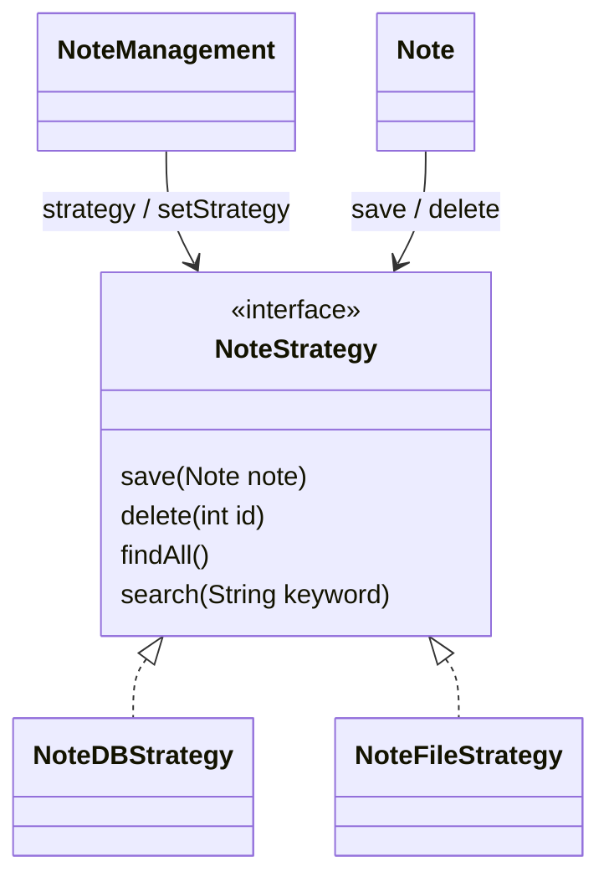

# Case Study iNotes — Bài nộp chung

Mã nguồn chạy được: [inotes-app](./inotes-app). File này gộp hướng dẫn, SQL, toàn bộ mã nguồn và kết quả kiểm thử.

## Chức năng đã triển khai

- Thêm, xem chi tiết, sửa và xoá ghi chú.
- Tìm trong tiêu đề/nội dung; lọc theo Cá nhân, Công việc, Học tập.
- Chuyển File/MySQL tại runtime bằng setStrategy; giao diện và nghiệp vụ không đổi.
- Lựa chọn kho theo phiên trình duyệt. Hai kho lưu riêng, không tự di chuyển dữ liệu.
- Model Note có getter/setter, save() và delete(int id). NoteManagement có addNote, searchNotes, deleteNote.
- Kiểm tra dữ liệu, escape nội dung hiển thị, POST cho ghi/xoá/chuyển kho, kiểm tra CSRF và từ chối form của kho cũ.
- Kho File hoạt động ngay cả khi chưa cấu hình MySQL.

## Kiến trúc Strategy Pattern



NoteServlet điều phối request, NoteManagement xử lý nghiệp vụ, các strategy thực hiện lưu trữ. JSP dùng chung cho cả hai kho. Các phương thức findTypes/name bổ sung metadata phục vụ cùng giao diện.

## Build và chạy

1. Dùng JDK 17, Maven và Tomcat 10.1.
2. Mở schema.sql trong MySQL Workbench và chạy để tạo inotes_db, hai bảng và ba danh mục. Bước này cần cho kho MySQL; kho File không phụ thuộc MySQL.
3. Trong thư mục inotes-app, chạy:

```shell
mvn clean package
```

4. Copy target/inotes.war vào webapps của Tomcat.
5. Thiết lập biến môi trường trước khi khởi động Tomcat:

| Biến | Ý nghĩa |
|---|---|
| INOTES_DATA_DIR | Thư mục dữ liệu file, ngoài thư mục deploy. Mặc định: inotes-data trong catalina.base. |
| INOTES_DB_URL | JDBC URL của MySQL, mặc định localhost:3306/inotes_db. |
| INOTES_DB_USER | Tài khoản MySQL, mặc định root cho môi trường thực hành. |
| INOTES_DB_PASSWORD | Mật khẩu MySQL; truyền qua môi trường, không ghi vào mã nguồn. |

6. Chạy startup.bat hoặc startup.sh, mở http://localhost:8080/inotes/. Mặc định là File; chọn MySQL rồi bấm Chuyển kho.

Ví dụ JDBC URL: jdbc:mysql://127.0.0.1:3306/inotes_db?characterEncoding=UTF-8&connectTimeout=3000&socketTimeout=5000. Dùng tài khoản/mật khẩu của môi trường bạn.

GitHub hiển thị mã nguồn, không chạy Servlet. Khi MySQL không truy cập được, chuyển kho bị từ chối và kho hiện tại được giữ nguyên.

## Định dạng file

notes.txt dùng UTF-8, mỗi ghi chú một dòng theo id|title|content|typeId. Ký tự đặc biệt được escape: dấu gạch chéo ngược thành \\, dấu | thành \|, xuống dòng thành \n và \r. Đọc lại giải mã nguyên vẹn nội dung. next-id.txt giữ bộ đếm để không tái sử dụng ID đã xoá; notes.lock phối hợp các thao tác ghi.

Ghi file bằng bản tạm và move trong cùng thư mục; ưu tiên atomic move nếu filesystem hỗ trợ. File lỗi không bị bỏ qua hoặc tự ghi đè. Tìm kiếm File hỗ trợ chữ Việt không dấu; MySQL dùng collation utf8mb4_unicode_ci và tham số LIKE đã escape ký tự wildcard.

## Kiểm chứng thực tế

- JDK 17, Maven 3.9.9, Tomcat 10.1.61, MySQL 8.4.11; thử trên server riêng.
- BUILD SUCCESS; 7 kiểm thử JUnit đạt, 0 lỗi, 0 bỏ qua.
- 28 kiểm tra HTTP đạt, bao gồm CRUD File/MySQL, chuyển kho, dữ liệu Unicode, tìm kiếm và trường hợp MySQL ngừng hoạt động.
- Đã dừng các server thử sau khi hoàn thành. Chưa kiểm tra trực quan hoặc chụp ảnh trong trình duyệt.

```text
Tests run: 7, Failures: 0, Errors: 0, Skipped: 0
BUILD SUCCESS
Default file storage: PASS
Create form rendered: PASS
File create via POST: PASS
View escapes HTML content: PASS
File Unicode and multiline rendered: PASS
Edit form loads saved note: PASS
File update via POST: PASS
Search by content: PASS
Category filter excludes other types: PASS
Category filter includes matching type: PASS
Blank title rejected by server: PASS
Invalid type rejected: PASS
Missing CSRF rejected: PASS
Runtime switch to MySQL: PASS
File notes are separate from MySQL: PASS
Stale storage form rejected: PASS
MySQL create via JDBC: PASS
MySQL Unicode and HTML escaping: PASS
MySQL literal percent search: PASS
MySQL underscore is not a wildcard: PASS
Prepared search does not interpolate SQL: PASS
MySQL update via JDBC: PASS
MySQL updated content and type: PASS
Storage selection scoped to session: PASS
MySQL delete via JDBC: PASS
Switch back preserves file data: PASS
File delete via POST: PASS
Unavailable MySQL switch keeps File storage and reports error: PASS

```

## Phạm vi

Ứng dụng bám schema đề bài, dùng một workspace ghi chú chung, chưa thêm đăng nhập và phân quyền theo người dùng. Kho MySQL lấy danh mục từ note_type; kho File có ba danh mục mặc định. Giới hạn nhập: tiêu đề 255 ký tự, nội dung 10.000 ký tự.

## Toàn bộ mã nguồn

### pom.xml

```xml
<?xml version="1.0" encoding="UTF-8"?>
<project xmlns="http://maven.apache.org/POM/4.0.0"
         xmlns:xsi="http://www.w3.org/2001/XMLSchema-instance"
         xsi:schemaLocation="http://maven.apache.org/POM/4.0.0 https://maven.apache.org/xsd/maven-4.0.0.xsd">
    <modelVersion>4.0.0</modelVersion>
    <groupId>com.codegym</groupId>
    <artifactId>inotes-app</artifactId>
    <version>1.0-SNAPSHOT</version>
    <packaging>war</packaging>
    <properties>
        <maven.compiler.release>17</maven.compiler.release>
        <project.build.sourceEncoding>UTF-8</project.build.sourceEncoding>
    </properties>
    <dependencies>
        <dependency>
            <groupId>jakarta.servlet</groupId>
            <artifactId>jakarta.servlet-api</artifactId>
            <version>6.0.0</version>
            <scope>provided</scope>
        </dependency>
        <dependency>
            <groupId>com.mysql</groupId>
            <artifactId>mysql-connector-j</artifactId>
            <version>26.7.0</version>
        </dependency>
        <dependency>
            <groupId>org.junit.jupiter</groupId>
            <artifactId>junit-jupiter</artifactId>
            <version>5.11.4</version>
            <scope>test</scope>
        </dependency>
    </dependencies>
    <build>
        <finalName>inotes</finalName>
        <plugins>
            <plugin>
                <groupId>org.apache.maven.plugins</groupId>
                <artifactId>maven-compiler-plugin</artifactId>
                <version>3.13.0</version>
            </plugin>
            <plugin>
                <groupId>org.apache.maven.plugins</groupId>
                <artifactId>maven-war-plugin</artifactId>
                <version>3.4.0</version>
            </plugin>
            <plugin>
                <groupId>org.apache.maven.plugins</groupId>
                <artifactId>maven-surefire-plugin</artifactId>
                <version>3.2.5</version>
            </plugin>
        </plugins>
    </build>
</project>

```

### schema.sql

```sql
CREATE DATABASE IF NOT EXISTS `inotes_db`
    CHARACTER SET utf8mb4 COLLATE utf8mb4_unicode_ci;
USE `inotes_db`;

CREATE TABLE IF NOT EXISTS `note_type` (
    `id` INT AUTO_INCREMENT PRIMARY KEY,
    `name` VARCHAR(100) NOT NULL,
    `description` VARCHAR(255)
) ENGINE=InnoDB;

CREATE TABLE IF NOT EXISTS `notes` (
    `id` INT AUTO_INCREMENT PRIMARY KEY,
    `title` VARCHAR(255) NOT NULL,
    `content` TEXT,
    `type_id` INT NOT NULL,
    CONSTRAINT `FK_Notes_Type` FOREIGN KEY (`type_id`)
        REFERENCES `note_type` (`id`) ON DELETE RESTRICT
) ENGINE=InnoDB;

-- Không ghi đè danh mục có sẵn khi chạy lại.
INSERT IGNORE INTO `note_type` (`id`, `name`, `description`)
VALUES (1, 'Cá nhân', 'Ghi chú cá nhân'),
       (2, 'Công việc', 'Công việc cần ghi nhớ'),
       (3, 'Học tập', 'Nội dung học tập');

```

### src/main/java/com/codegym/inotes/model/Note.java

```java
package com.codegym.inotes.model;

import com.codegym.inotes.storage.NoteStrategy;

public class Note {
    private int id;
    private String title;
    private String content;
    private int typeId;
    private transient NoteStrategy strategy;

    public Note() { }

    public Note(int id, String title, String content, int typeId) {
        this.id = id;
        this.title = title;
        this.content = content;
        this.typeId = typeId;
    }

    public int getId() { return id; }
    public void setId(int id) { this.id = id; }
    public String getTitle() { return title; }
    public void setTitle(String title) { this.title = title; }
    public String getContent() { return content; }
    public void setContent(String content) { this.content = content; }
    public int getTypeId() { return typeId; }
    public void setTypeId(int typeId) { this.typeId = typeId; }
    public void setStrategy(NoteStrategy strategy) { this.strategy = strategy; }

    public void validate() {
        if (id < 0) throw new IllegalArgumentException("ID không hợp lệ.");
        if (title == null || title.isBlank()) throw new IllegalArgumentException("Vui lòng nhập tiêu đề.");
        title = title.strip();
        if (title.length() > 255) throw new IllegalArgumentException("Tiêu đề tối đa 255 ký tự.");
        if (content == null) content = "";
        if (content.length() > 10000) throw new IllegalArgumentException("Nội dung tối đa 10.000 ký tự.");
        if (typeId <= 0) throw new IllegalArgumentException("Vui lòng chọn phân loại.");
    }

    public void save() {
        if (strategy == null) throw new IllegalStateException("Chưa chọn chiến lược lưu trữ.");
        strategy.save(this);
    }

    public void delete(int id) {
        if (strategy == null) throw new IllegalStateException("Chưa chọn chiến lược lưu trữ.");
        strategy.delete(id);
    }
}

```

### src/main/java/com/codegym/inotes/model/NoteType.java

```java
package com.codegym.inotes.model;

public record NoteType(int id, String name, String description) { }

```

### src/main/java/com/codegym/inotes/service/NoteManagement.java

```java
package com.codegym.inotes.service;

import com.codegym.inotes.model.Note;
import com.codegym.inotes.model.NoteType;
import com.codegym.inotes.storage.NoteStrategy;
import java.util.List;
import java.util.Objects;

public class NoteManagement {
    private NoteStrategy strategy;

    public NoteManagement(NoteStrategy strategy) { setStrategy(strategy); }
    public void setStrategy(NoteStrategy strategy) { this.strategy = Objects.requireNonNull(strategy); }
    public String storageName() { return strategy.name(); }
    public List<NoteType> findTypes() { return strategy.findTypes(); }
    public List<Note> findAll() { return strategy.findAll(); }
    public List<Note> searchNotes(String keyword) { return strategy.search(keyword); }

    public Note findById(int id) {
        return strategy.findAll().stream().filter(note -> note.getId() == id).findFirst()
                .orElseThrow(() -> new IllegalArgumentException("Không tìm thấy ghi chú."));
    }

    public Note addNote(String title, String content, int typeId) {
        return saveNote(0, title, content, typeId);
    }

    public Note saveNote(int id, String title, String content, int typeId) {
        Note note = new Note(id, title, content, typeId);
        note.setStrategy(strategy);
        note.save();
        return note;
    }

    public void deleteNote(int id) {
        Note note = new Note();
        note.setStrategy(strategy);
        note.delete(id);
    }
}

```

### src/main/java/com/codegym/inotes/storage/NoteDBStrategy.java

```java
package com.codegym.inotes.storage;

import com.codegym.inotes.model.Note;
import com.codegym.inotes.model.NoteType;
import java.sql.*;
import java.util.ArrayList;
import java.util.List;

public class NoteDBStrategy implements NoteStrategy {
    private final String url;
    private final String user;
    private final String password;

    public NoteDBStrategy(String url, String user, String password) {
        this.url = url;
        this.user = user;
        this.password = password;
        try { Class.forName("com.mysql.cj.jdbc.Driver"); }
        catch (ClassNotFoundException e) { throw new StorageException("Thiếu MySQL Connector/J.", e); }
    }

    private Connection connect() throws SQLException { return DriverManager.getConnection(url, user, password); }
    @Override public String name() { return "mysql"; }

    @Override
    public void save(Note note) {
        note.validate();
        try (Connection connection = connect()) {
            try (PreparedStatement type = connection.prepareStatement("SELECT id FROM note_type WHERE id = ?")) {
                type.setInt(1, note.getTypeId());
                try (ResultSet rs = type.executeQuery()) {
                    if (!rs.next()) throw new IllegalArgumentException("Phân loại không tồn tại.");
                }
            }
            boolean creating = note.getId() == 0;
            String sql = creating ? "INSERT INTO notes(title, content, type_id) VALUES (?, ?, ?)"
                    : "UPDATE notes SET title = ?, content = ?, type_id = ? WHERE id = ?";
            try (PreparedStatement statement = connection.prepareStatement(sql, Statement.RETURN_GENERATED_KEYS)) {
                statement.setString(1, note.getTitle());
                statement.setString(2, note.getContent());
                statement.setInt(3, note.getTypeId());
                if (!creating) statement.setInt(4, note.getId());
                int affected = statement.executeUpdate();
                if (!creating && affected == 0 && !exists(connection, note.getId()))
                    throw new IllegalArgumentException("Không tìm thấy ghi chú cần sửa.");
                if (creating) {
                    try (ResultSet keys = statement.getGeneratedKeys()) {
                        if (!keys.next()) throw new SQLException("Missing generated note ID");
                        note.setId(keys.getInt(1));
                    }
                }
            }
        } catch (SQLException e) { throw new StorageException("Không lưu được ghi chú vào MySQL.", e); }
    }

    private boolean exists(Connection connection, int id) throws SQLException {
        try (PreparedStatement statement = connection.prepareStatement("SELECT id FROM notes WHERE id = ?")) {
            statement.setInt(1, id);
            try (ResultSet rs = statement.executeQuery()) { return rs.next(); }
        }
    }

    @Override
    public void delete(int id) {
        if (id <= 0) throw new IllegalArgumentException("ID không hợp lệ.");
        try (Connection connection = connect(); PreparedStatement statement = connection.prepareStatement("DELETE FROM notes WHERE id = ?")) {
            statement.setInt(1, id);
            if (statement.executeUpdate() == 0) throw new IllegalArgumentException("Không tìm thấy ghi chú cần xoá.");
        } catch (SQLException e) { throw new StorageException("Không xoá được ghi chú trong MySQL.", e); }
    }

    @Override public List<Note> findAll() { return query("SELECT id, title, content, type_id FROM notes ORDER BY id DESC", null); }

    @Override
    public List<Note> search(String keyword) {
        String value = keyword == null ? "" : keyword.strip();
        if (value.isEmpty()) return findAll();
        String pattern = "%" + value.replace("!", "!!").replace("%", "!%").replace("_", "!_") + "%";
        return query("SELECT id, title, content, type_id FROM notes WHERE title LIKE ? ESCAPE '!' OR content LIKE ? ESCAPE '!' ORDER BY id DESC", pattern);
    }

    private List<Note> query(String sql, String pattern) {
        List<Note> notes = new ArrayList<>();
        try (Connection connection = connect(); PreparedStatement statement = connection.prepareStatement(sql)) {
            if (pattern != null) { statement.setString(1, pattern); statement.setString(2, pattern); }
            try (ResultSet rs = statement.executeQuery()) {
                while (rs.next()) {
                    Note note = new Note(rs.getInt("id"), rs.getString("title"), rs.getString("content"), rs.getInt("type_id"));
                    note.setStrategy(this);
                    notes.add(note);
                }
            }
            return notes;
        } catch (SQLException e) { throw new StorageException("Không đọc được ghi chú từ MySQL.", e); }
    }

    @Override
    public List<NoteType> findTypes() {
        List<NoteType> types = new ArrayList<>();
        try (Connection connection = connect(); PreparedStatement statement = connection.prepareStatement("SELECT id, name, description FROM note_type ORDER BY id"); ResultSet rs = statement.executeQuery()) {
            while (rs.next()) types.add(new NoteType(rs.getInt("id"), rs.getString("name"), rs.getString("description")));
            return types;
        } catch (SQLException e) { throw new StorageException("Không đọc được phân loại từ MySQL.", e); }
    }
}

```

### src/main/java/com/codegym/inotes/storage/NoteFileStrategy.java

```java
package com.codegym.inotes.storage;

import com.codegym.inotes.model.Note;
import com.codegym.inotes.model.NoteType;
import java.io.IOException;
import java.nio.channels.FileChannel;
import java.nio.channels.FileLock;
import java.nio.charset.StandardCharsets;
import java.nio.file.*;
import java.text.Normalizer;
import java.util.*;
import java.util.concurrent.ConcurrentHashMap;
import java.util.concurrent.locks.ReentrantLock;

public class NoteFileStrategy implements NoteStrategy {
    private static final Map<Path, ReentrantLock> LOCKS = new ConcurrentHashMap<>();
    private static final List<NoteType> TYPES = List.of(
            new NoteType(1, "Cá nhân", "Ghi chú cá nhân"),
            new NoteType(2, "Công việc", "Công việc cần ghi nhớ"),
            new NoteType(3, "Học tập", "Nội dung học tập"));
    private final Path directory;

    public NoteFileStrategy(Path directory) { this.directory = directory.toAbsolutePath().normalize(); }
    @Override public String name() { return "file"; }
    @Override public List<NoteType> findTypes() { return TYPES; }

    @FunctionalInterface private interface Operation<T> { T run() throws IOException; }
    private <T> T locked(Operation<T> operation) {
        ReentrantLock lock = LOCKS.computeIfAbsent(directory, key -> new ReentrantLock());
        lock.lock();
        try {
            Files.createDirectories(directory);
            try (FileChannel channel = FileChannel.open(directory.resolve("notes.lock"), StandardOpenOption.CREATE, StandardOpenOption.WRITE);
                 FileLock ignored = channel.lock()) {
                return operation.run();
            }
        } catch (IOException e) { throw new StorageException("Không đọc/ghi được file ghi chú.", e); }
        finally { lock.unlock(); }
    }

    @Override
    public void save(Note note) {
        note.validate();
        if (TYPES.stream().noneMatch(type -> type.id() == note.getTypeId()))
            throw new IllegalArgumentException("Phân loại không tồn tại.");
        locked(() -> {
            List<Note> notes = readNotes();
            if (note.getId() == 0) {
                int max = notes.stream().mapToInt(Note::getId).max().orElse(0);
                Path sequencePath = directory.resolve("next-id.txt");
                int next = Math.addExact(max, 1);
                if (Files.exists(sequencePath)) {
                    try { next = Math.max(next, Integer.parseInt(Files.readString(sequencePath).strip())); }
                    catch (NumberFormatException e) { throw new IOException("Invalid ID sequence", e); }
                }
                if (next <= 0) throw new IOException("Invalid ID sequence");
                // Giữ high-water mark trước khi lưu; lỗi ghi có thể tạo khoảng trống ID, không tái sử dụng ID.
                atomicWrite(sequencePath, Integer.toString(Math.addExact(next, 1)));
                Note stored = new Note(next, note.getTitle(), note.getContent(), note.getTypeId());
                notes.add(stored);
                writeNotes(notes);
                note.setId(next);
            } else {
                int position = -1;
                for (int i = 0; i < notes.size(); i++) if (notes.get(i).getId() == note.getId()) { position = i; break; }
                if (position < 0) throw new IllegalArgumentException("Không tìm thấy ghi chú cần sửa.");
                notes.set(position, new Note(note.getId(), note.getTitle(), note.getContent(), note.getTypeId()));
                writeNotes(notes);
            }
            return null;
        });
    }

    @Override
    public void delete(int id) {
        if (id <= 0) throw new IllegalArgumentException("ID không hợp lệ.");
        locked(() -> {
            List<Note> notes = readNotes();
            if (!notes.removeIf(note -> note.getId() == id)) throw new IllegalArgumentException("Không tìm thấy ghi chú cần xoá.");
            writeNotes(notes);
            return null;
        });
    }

    @Override
    public List<Note> findAll() {
        return locked(() -> readNotes().stream().sorted(Comparator.comparingInt(Note::getId).reversed()).toList());
    }

    private static String folded(String value) {
        return Normalizer.normalize(value == null ? "" : value.toLowerCase(Locale.ROOT), Normalizer.Form.NFD)
                .replaceAll("\\p{M}", "").replace('đ', 'd');
    }

    @Override
    public List<Note> search(String keyword) {
        String query = folded(keyword == null ? "" : keyword.strip());
        return findAll().stream().filter(note -> folded(note.getTitle()).contains(query) || folded(note.getContent()).contains(query)).toList();
    }

    private List<Note> readNotes() throws IOException {
        Path path = directory.resolve("notes.txt");
        List<Note> notes = new ArrayList<>();
        if (!Files.exists(path)) return notes;
        Set<Integer> ids = new HashSet<>();
        int lineNumber = 0;
        for (String line : Files.readAllLines(path, StandardCharsets.UTF_8)) {
            lineNumber++;
            if (line.isEmpty()) continue;
            List<String> fields = decode(line);
            try {
                if (fields.size() != 4) throw new IllegalArgumentException("Expected four fields");
                Note note = new Note(Integer.parseInt(fields.get(0)), fields.get(1), fields.get(2), Integer.parseInt(fields.get(3)));
                note.validate();
                if (note.getId() <= 0 || !ids.add(note.getId()) || TYPES.stream().noneMatch(type -> type.id() == note.getTypeId()))
                    throw new IllegalArgumentException("Invalid record");
                note.setStrategy(this);
                notes.add(note);
            } catch (IllegalArgumentException e) { throw new IOException("Invalid note at line " + lineNumber, e); }
        }
        return notes;
    }

    private static String encode(String value) {
        return value.replace("\\", "\\\\").replace("|", "\\|").replace("\n", "\\n").replace("\r", "\\r");
    }

    private static List<String> decode(String line) throws IOException {
        List<String> fields = new ArrayList<>();
        StringBuilder field = new StringBuilder();
        boolean escaped = false;
        for (char character : line.toCharArray()) {
            if (escaped) {
                switch (character) {
                    case 'n' -> field.append('\n');
                    case 'r' -> field.append('\r');
                    case '\\', '|' -> field.append(character);
                    default -> throw new IOException("Invalid escape sequence in notes file");
                }
                escaped = false;
            } else if (character == '\\') escaped = true;
            else if (character == '|') { fields.add(field.toString()); field.setLength(0); }
            else field.append(character);
        }
        if (escaped) throw new IOException("Incomplete escape sequence in notes file");
        fields.add(field.toString());
        return fields;
    }

    private void writeNotes(List<Note> notes) throws IOException {
        StringBuilder text = new StringBuilder();
        for (Note note : notes) text.append(note.getId()).append('|').append(encode(note.getTitle())).append('|')
                .append(encode(note.getContent())).append('|').append(note.getTypeId()).append('\n');
        atomicWrite(directory.resolve("notes.txt"), text.toString());
    }

    private void atomicWrite(Path destination, String content) throws IOException {
        Path temporary = Files.createTempFile(directory, "inotes-", ".tmp");
        try {
            Files.writeString(temporary, content, StandardCharsets.UTF_8);
            try { Files.move(temporary, destination, StandardCopyOption.ATOMIC_MOVE, StandardCopyOption.REPLACE_EXISTING); }
            catch (AtomicMoveNotSupportedException e) { Files.move(temporary, destination, StandardCopyOption.REPLACE_EXISTING); }
        } finally { Files.deleteIfExists(temporary); }
    }
}

```

### src/main/java/com/codegym/inotes/storage/NoteStrategy.java

```java
package com.codegym.inotes.storage;

import com.codegym.inotes.model.Note;
import com.codegym.inotes.model.NoteType;
import java.util.List;

public interface NoteStrategy {
    void save(Note note);
    void delete(int id);
    List<Note> findAll();
    List<Note> search(String keyword);
    List<NoteType> findTypes();
    String name();
}

```

### src/main/java/com/codegym/inotes/storage/StorageException.java

```java
package com.codegym.inotes.storage;

public class StorageException extends RuntimeException {
    public StorageException(String message, Throwable cause) { super(message, cause); }
}

```

### src/main/java/com/codegym/inotes/web/Html.java

```java
package com.codegym.inotes.web;

public final class Html {
    private Html() { }
    public static String escape(String value) {
        if (value == null) return "";
        return value.replace("&", "&amp;").replace("<", "&lt;").replace(">", "&gt;")
                .replace("\"", "&quot;").replace("'", "&#39;");
    }
}

```

### src/main/java/com/codegym/inotes/web/NoteServlet.java

```java
package com.codegym.inotes.web;

import com.codegym.inotes.model.Note;
import com.codegym.inotes.model.NoteType;
import com.codegym.inotes.service.NoteManagement;
import com.codegym.inotes.storage.*;
import jakarta.servlet.ServletException;
import jakarta.servlet.http.*;
import java.io.IOException;
import java.nio.file.Path;
import java.util.List;
import java.util.Set;
import java.util.UUID;

public class NoteServlet extends HttpServlet {
    private NoteStrategy fileStorage;
    private NoteStrategy databaseStorage;

    private static String environment(String key, String fallback) {
        String value = System.getenv(key);
        return value == null ? fallback : value;
    }

    @Override
    public void init() {
        Path directory = Path.of(environment("INOTES_DATA_DIR",
                Path.of(System.getProperty("catalina.base", System.getProperty("user.dir")), "inotes-data").toString()));
        fileStorage = new NoteFileStrategy(directory);
        databaseStorage = new NoteDBStrategy(
                environment("INOTES_DB_URL", "jdbc:mysql://127.0.0.1:3306/inotes_db?characterEncoding=UTF-8&connectTimeout=3000&socketTimeout=5000"),
                environment("INOTES_DB_USER", "root"), environment("INOTES_DB_PASSWORD", ""));
    }

    private NoteManagement management(HttpSession session) {
        NoteManagement management = (NoteManagement) session.getAttribute("management");
        if (management == null) {
            management = new NoteManagement(fileStorage);
            session.setAttribute("management", management);
        }
        if (session.getAttribute("csrf") == null) session.setAttribute("csrf", UUID.randomUUID().toString());
        return management;
    }

    private static int number(String value, int fallback) {
        if (value == null || value.isBlank()) return fallback;
        try { return Integer.parseInt(value); }
        catch (NumberFormatException e) { throw new IllegalArgumentException("Mã số không hợp lệ."); }
    }

    @Override
    protected void doGet(HttpServletRequest request, HttpServletResponse response) throws ServletException, IOException {
        response.setHeader("Cache-Control", "no-store");
        HttpSession session = request.getSession();
        synchronized (session) {
            NoteManagement management = management(session);
            String action = request.getParameter("action");
            if (action == null) action = "list";
            if (!Set.of("list", "new", "edit", "view").contains(action)) { response.sendError(400); return; }
            String keyword = request.getParameter("q");
            if (keyword == null) keyword = "";
            if (keyword.length() > 200) { response.sendError(400, "Từ khoá tối đa 200 ký tự."); return; }
            int type;
            try { type = number(request.getParameter("type"), 0); }
            catch (IllegalArgumentException e) { response.sendError(400); return; }
            request.setAttribute("mode", action);
            request.setAttribute("keyword", keyword);
            request.setAttribute("typeFilter", type);
            request.setAttribute("storage", management.storageName());
            String[] flash = (String[]) session.getAttribute("flash");
            session.removeAttribute("flash");
            if (flash != null) {
                request.setAttribute("message", flash[1]);
                request.setAttribute("messageError", "error".equals(flash[0]));
            }
            try {
                List<NoteType> types = management.findTypes();
                List<Note> notes = management.searchNotes(keyword);
                if (type > 0) notes = notes.stream().filter(note -> note.getTypeId() == type).toList();
                request.setAttribute("types", types);
                request.setAttribute("notes", notes);
                if (action.equals("edit") || action.equals("view"))
                    request.setAttribute("selected", management.findById(number(request.getParameter("id"), 0)));
            } catch (IllegalArgumentException e) { response.sendError(404, "Không tìm thấy ghi chú."); return; }
            catch (StorageException e) {
                getServletContext().log("iNotes storage read failed", e);
                request.setAttribute("types", List.of());
                request.setAttribute("notes", List.of());
                request.setAttribute("mode", "list");
                request.setAttribute("messageError", true);
                request.setAttribute("message", "Không đọc được kho dữ liệu. Kiểm tra cấu hình hoặc chuyển sang File.");
                response.setStatus(503);
            }
            request.getRequestDispatcher("/WEB-INF/views/notes.jsp").forward(request, response);
        }
    }

    @Override
    protected void doPost(HttpServletRequest request, HttpServletResponse response) throws IOException {
        request.setCharacterEncoding("UTF-8");
        HttpSession session = request.getSession(false);
        if (session == null) { response.sendError(403, "Vui lòng tải lại trang."); return; }
        synchronized (session) {
            NoteManagement management = management(session);
            String csrf = (String) session.getAttribute("csrf");
            if (!csrf.equals(request.getParameter("csrf"))) { response.sendError(403, "Yêu cầu không hợp lệ."); return; }
            try {
                String action = request.getParameter("action");
                if ("switch".equals(action)) {
                    String storage = request.getParameter("storage");
                    NoteStrategy candidate;
                    if ("file".equals(storage)) candidate = fileStorage;
                    else if ("mysql".equals(storage)) candidate = databaseStorage;
                    else throw new IllegalArgumentException("Kho dữ liệu không hợp lệ.");
                    // Thử truy cập trước; thất bại không thay đổi chiến lược hiện tại.
                    candidate.findTypes();
                    candidate.findAll();
                    management.setStrategy(candidate);
                    session.setAttribute("flash", new String[]{"success", "Đã chuyển sang " + (storage.equals("file") ? "File" : "MySQL") + "."});
                } else {
                    if (!management.storageName().equals(request.getParameter("_storage")))
                        throw new IllegalArgumentException("Kho dữ liệu đã đổi. Vui lòng tải lại form trước khi lưu hoặc xoá.");
                    if ("save".equals(action)) {
                        management.saveNote(number(request.getParameter("id"), 0), request.getParameter("title"),
                                request.getParameter("content"), number(request.getParameter("typeId"), 0));
                        session.setAttribute("flash", new String[]{"success", "Đã lưu ghi chú."});
                    } else if ("delete".equals(action)) {
                        management.deleteNote(number(request.getParameter("id"), 0));
                        session.setAttribute("flash", new String[]{"success", "Đã xoá ghi chú."});
                    } else throw new IllegalArgumentException("Thao tác không hợp lệ.");
                }
            } catch (IllegalArgumentException e) { session.setAttribute("flash", new String[]{"error", e.getMessage()}); }
            catch (StorageException e) {
                getServletContext().log("iNotes storage write/switch failed", e);
                session.setAttribute("flash", new String[]{"error", "Không truy cập được kho dữ liệu. Kiểm tra file hoặc cấu hình MySQL; thao tác chưa hoàn tất."});
            }
            response.sendRedirect(request.getContextPath() + "/notes");
        }
    }
}

```

### src/main/webapp/WEB-INF/views/notes.jsp

```jsp
<%@ page contentType="text/html; charset=UTF-8" pageEncoding="UTF-8" %>
<%@ page import="java.util.*,com.codegym.inotes.model.*,com.codegym.inotes.web.Html" %>
<%
    List<Note> notes = (List<Note>) request.getAttribute("notes");
    List<NoteType> types = (List<NoteType>) request.getAttribute("types");
    Map<Integer, String> typeNames = new HashMap<>();
    for (NoteType type : types) typeNames.put(type.id(), type.name());
    String mode = (String) request.getAttribute("mode");
    String storage = (String) request.getAttribute("storage");
    String csrf = (String) session.getAttribute("csrf");
    String keyword = (String) request.getAttribute("keyword");
    int typeFilter = (Integer) request.getAttribute("typeFilter");
    String message = (String) request.getAttribute("message");
    boolean messageError = Boolean.TRUE.equals(request.getAttribute("messageError"));
    Note selected = (Note) request.getAttribute("selected");
    String base = request.getContextPath() + "/notes";
%>
<!doctype html>
<html lang="vi">
<head>
    <meta charset="UTF-8">
    <meta name="viewport" content="width=device-width, initial-scale=1">
    <title>iNotes — Quản lý ghi chú</title>
    <style>
        * { box-sizing: border-box; }
        body { margin: 0; background: #f5f7fa; color: #26354b; font-family: Arial, sans-serif; }
        .container { max-width: 1050px; margin: 32px auto; padding: 0 20px; }
        .top, .storage, .toolbar, .actions { display: flex; align-items: center; flex-wrap: wrap; gap: 12px; }
        .top { justify-content: space-between; margin-bottom: 20px; }
        h1 { margin: 0 0 6px; font-size: 34px; }
        h2 { margin: 0 0 24px; font-size: 24px; }
        p { line-height: 1.6; }
        .muted { color: #6d7b8e; font-size: 14px; margin: 0; }
        .storage { border: 1px solid #dce3ed; padding: 12px; border-radius: 8px; background: white; }
        .card { background: white; border: 1px solid #e0e5ed; border-radius: 10px; padding: 24px; margin: 20px 0; }
        .notice { margin: 16px 0; padding: 14px; border-radius: 6px; background: #e8f4ee; color: #286547; }
        .notice.error { background: #fff0f0; color: #9f2834; }
        input, select, textarea, button { font: inherit; }
        input, select, textarea { max-width: 100%; padding: 10px 12px; border: 1px solid #cbd5e1; border-radius: 5px; background: white; color: inherit; }
        input:focus-visible, select:focus-visible, textarea:focus-visible, button:focus-visible, a:focus-visible { outline: 2px solid #4571c4; outline-offset: 2px; }
        .btn, button { display: inline-block; padding: 10px 14px; border: 1px solid #315fb1; border-radius: 5px; background: #315fb1; color: white; text-decoration: none; cursor: pointer; }
        .btn.secondary { border-color: #cbd5e1; background: white; color: #41546e; }
        button:disabled { opacity: .5; cursor: not-allowed; }
        .toolbar input { flex: 1 1 220px; min-width: 0; }
        .table-wrapper { overflow-x: auto; }
        table { width: 100%; border-collapse: collapse; margin-top: 22px; }
        th, td { text-align: left; padding: 15px 10px; border-bottom: 1px solid #edf0f4; }
        th { font-size: 13px; color: #6d7b8e; }
        .title-cell { max-width: 420px; overflow-wrap: anywhere; }
        .badge { display: inline-block; padding: 5px 8px; border-radius: 20px; font-size: 12px; color: #4166a2; background: #eef3fb; white-space: nowrap; }
        .actions { gap: 10px; }
        .actions a { color: #315fb1; font-size: 14px; text-decoration: none; }
        .actions a:hover { text-decoration: underline; }
        .actions form { margin: 0; }
        .delete { padding: 0; border: 0; background: transparent; color: #a53442; font-size: 14px; }
        .field { margin-bottom: 20px; }
        .field label { display: block; margin-bottom: 8px; font-size: 14px; font-weight: bold; }
        .field input, .field select, .field textarea { width: 100%; }
        textarea { min-height: 200px; resize: vertical; line-height: 1.6; }
        .note-content { white-space: pre-wrap; overflow-wrap: anywhere; line-height: 1.8; font-family: inherit; margin: 24px 0; }
        .empty { padding: 28px 0; text-align: center; color: #6d7b8e; }
        footer { text-align: center; font-size: 12px; color: #7a8799; margin: 24px 0; }
        @media(max-width: 600px) { .container { padding: 0 12px; margin-top: 20px; } .card { padding: 16px; } .storage { width: 100%; } .toolbar > select { width: 100%; } th, td { padding: 12px 7px; } }
    </style>
</head>
<body>
    <main class="container">
        <div class="top">
            <div><h1>iNotes</h1><p class="muted">Ghi lại điều quan trọng, tìm lại khi cần.</p></div>
            <form class="storage" action="<%= base %>" method="post">
                <input type="hidden" name="csrf" value="<%= csrf %>">
                <input type="hidden" name="action" value="switch">
                <label for="storage">Kho dữ liệu</label>
                <select id="storage" name="storage">
                    <option value="file" <%= "file".equals(storage) ? "selected" : "" %>>File</option>
                    <option value="mysql" <%= "mysql".equals(storage) ? "selected" : "" %>>MySQL</option>
                </select>
                <button type="submit">Chuyển kho</button>
            </form>
        </div>
        <p class="muted" id="active-storage">Đang dùng: <strong><%= "mysql".equals(storage) ? "MySQL" : "File" %></strong>. Hai kho lưu riêng; chuyển kho không tự sao chép ghi chú.</p>
        <% if (message != null) { %>
            <div class="notice <%= messageError ? "error" : "" %>" role="status"><%= Html.escape(message) %></div>
        <% } %>

        <% if ("new".equals(mode) || "edit".equals(mode)) { %>
            <div class="card">
                <h2><%= selected == null ? "Thêm mới ghi chú" : "Sửa ghi chú" %></h2>
                <form action="<%= base %>" method="post">
                    <input type="hidden" name="csrf" value="<%= csrf %>">
                    <input type="hidden" name="_storage" value="<%= storage %>">
                    <input type="hidden" name="action" value="save">
                    <input type="hidden" name="id" value="<%= selected == null ? 0 : selected.getId() %>">
                    <div class="field"><label for="title">Tiêu đề</label><input id="title" name="title" maxlength="255" value="<%= Html.escape(selected == null ? "" : selected.getTitle()) %>" required autofocus></div>
                    <div class="field"><label for="typeId">Phân loại</label><select id="typeId" name="typeId" required>
                        <% for (NoteType type : types) { %>
                            <option value="<%= type.id() %>" <%= selected != null && selected.getTypeId() == type.id() ? "selected" : "" %>><%= Html.escape(type.name()) %></option>
                        <% } %>
                    </select></div>
                    <div class="field"><label for="content">Nội dung</label><textarea id="content" name="content" maxlength="10000"><%= Html.escape(selected == null ? "" : selected.getContent()) %></textarea></div>
                    <div class="actions"><button type="submit" <%= types.isEmpty() ? "disabled" : "" %>>Lưu ghi chú</button><a class="btn secondary" href="<%= base %>">Huỷ bỏ</a></div>
                </form>
            </div>
        <% } else if ("view".equals(mode) && selected != null) { %>
            <div class="card">
                <h2><%= Html.escape(selected.getTitle()) %></h2>
                <span class="badge"><%= Html.escape(typeNames.get(selected.getTypeId())) %></span>
                <pre class="note-content"><%= Html.escape(selected.getContent()) %></pre>
                <div class="actions"><a class="btn" href="<%= base %>?action=edit&amp;id=<%= selected.getId() %>">Sửa ghi chú</a><a class="btn secondary" href="<%= base %>">Về danh sách</a></div>
            </div>
        <% } else { %>
            <div class="card">
                <div class="top"><h2 class="muted">Danh sách ghi chú (<%= notes.size() %>)</h2><a class="btn" href="<%= base %>?action=new">+ Thêm mới</a></div>
                <form class="toolbar" action="<%= base %>" method="get">
                    <input name="q" type="search" value="<%= Html.escape(keyword) %>" maxlength="200" placeholder="Tìm trong tiêu đề hoặc nội dung…" aria-label="Tìm kiếm ghi chú">
                    <select name="type" aria-label="Lọc theo phân loại"><option value="0">Tất cả phân loại</option>
                        <% for (NoteType type : types) { %><option value="<%= type.id() %>" <%= typeFilter == type.id() ? "selected" : "" %>><%= Html.escape(type.name()) %></option><% } %>
                    </select>
                    <button type="submit">Tìm kiếm</button><a class="btn secondary" href="<%= base %>">Đặt lại</a>
                </form>
                <% if (notes.isEmpty()) { %><p class="empty">Chưa có ghi chú hoặc không tìm thấy kết quả phù hợp.</p><% } else { %>
                    <div class="table-wrapper"><table>
                        <thead><tr><th>#</th><th>Tiêu đề</th><th>Phân loại</th><th>Thao tác</th></tr></thead>
                        <tbody><% for (Note note : notes) { %><tr data-note-id="<%= note.getId() %>">
                            <td><%= note.getId() %></td><td class="title-cell"><%= Html.escape(note.getTitle()) %></td>
                            <td><span class="badge"><%= Html.escape(typeNames.get(note.getTypeId())) %></span></td>
                            <td><div class="actions">
                                <a href="<%= base %>?action=view&amp;id=<%= note.getId() %>">Xem</a>
                                <a href="<%= base %>?action=edit&amp;id=<%= note.getId() %>">Sửa</a>
                                <form action="<%= base %>" method="post" onsubmit="return confirm('Xoá ghi chú này?');">
                                    <input type="hidden" name="csrf" value="<%= csrf %>"><input type="hidden" name="_storage" value="<%= storage %>">
                                    <input type="hidden" name="action" value="delete"><input type="hidden" name="id" value="<%= note.getId() %>">
                                    <button class="delete" type="submit">Xoá</button>
                                </form>
                            </div></td>
                        </tr><% } %></tbody>
                    </table></div>
                <% } %>
            </div>
        <% } %>
        <footer>iNotes · Java Servlet/JSP · Strategy Pattern</footer>
    </main>
</body>
</html>

```

### src/main/webapp/WEB-INF/web.xml

```xml
<?xml version="1.0" encoding="UTF-8"?>
<web-app xmlns="https://jakarta.ee/xml/ns/jakartaee"
         xmlns:xsi="http://www.w3.org/2001/XMLSchema-instance"
         xsi:schemaLocation="https://jakarta.ee/xml/ns/jakartaee https://jakarta.ee/xml/ns/jakartaee/web-app_6_0.xsd"
         version="6.0">
    <display-name>iNotes</display-name>
    <servlet>
        <servlet-name>NoteServlet</servlet-name>
        <servlet-class>com.codegym.inotes.web.NoteServlet</servlet-class>
        <load-on-startup>1</load-on-startup>
    </servlet>
    <servlet-mapping>
        <servlet-name>NoteServlet</servlet-name>
        <url-pattern>/notes</url-pattern>
    </servlet-mapping>
    <welcome-file-list><welcome-file>notes</welcome-file></welcome-file-list>
    <session-config><session-timeout>30</session-timeout></session-config>
</web-app>

```

### src/test/java/com/codegym/inotes/NoteFileStrategyTest.java

```java
package com.codegym.inotes;

import com.codegym.inotes.model.Note;
import com.codegym.inotes.service.NoteManagement;
import com.codegym.inotes.storage.NoteFileStrategy;
import com.codegym.inotes.storage.StorageException;
import org.junit.jupiter.api.Test;
import org.junit.jupiter.api.io.TempDir;
import java.nio.file.*;
import java.util.*;
import java.util.concurrent.*;
import static org.junit.jupiter.api.Assertions.*;

class NoteFileStrategyTest {
    @TempDir Path directory;

    @Test void preservesUnicodeDelimitersAndMultilineContentAcrossReopen() {
        NoteFileStrategy strategy = new NoteFileStrategy(directory);
        Note note = new Note(0, "Học tập | Java \\ JSP", "Dòng 1 | nội dung\nDòng 2\\n\r\nDòng 3", 3);
        note.setStrategy(strategy);
        note.save();
        Note reopened = new NoteFileStrategy(directory).findAll().get(0);
        assertEquals(note.getTitle(), reopened.getTitle());
        assertEquals(note.getContent(), reopened.getContent());
        assertEquals(note.getId(), reopened.getId());
        assertEquals(3, reopened.getTypeId());
    }

    @Test void updatesAndDeletesUsingNoteModelWithoutReusingDeletedId() {
        NoteManagement management = new NoteManagement(new NoteFileStrategy(directory));
        Note note = management.addNote("Ban đầu", "Nội dung", 1);
        Note editable = management.findById(note.getId());
        editable.setTitle("Đã sửa");
        editable.setContent("Nội dung mới");
        editable.setTypeId(2);
        editable.save();
        assertEquals("Đã sửa", management.findById(note.getId()).getTitle());
        assertEquals(2, management.findById(note.getId()).getTypeId());
        editable.delete(note.getId());
        assertTrue(management.findAll().isEmpty());
        Note next = management.addNote("Tiếp theo", "", 1);
        assertTrue(next.getId() > note.getId());
        assertThrows(IllegalArgumentException.class, () -> management.deleteNote(note.getId()));
    }

    @Test void searchesTitleAndContentAndTreatsWildcardCharactersLiterally() {
        NoteManagement management = new NoteManagement(new NoteFileStrategy(directory));
        management.addNote("HỌC TẬP 50%", "Chi tiết Servlet", 3);
        management.addNote("Mua sách", "Danh sách cần nhớ", 1);
        assertEquals(1, management.searchNotes("hoc tap").size());
        assertEquals(1, management.searchNotes("servlet").size());
        assertEquals(1, management.searchNotes("%").size());
        assertEquals(0, management.searchNotes("_").size());
        assertEquals(2, management.searchNotes(null).size());
    }

    @Test void rejectsInvalidNotesBeforeWriting() {
        NoteManagement management = new NoteManagement(new NoteFileStrategy(directory));
        assertThrows(IllegalArgumentException.class, () -> management.addNote("   ", "text", 1));
        assertThrows(IllegalArgumentException.class, () -> management.addNote("x".repeat(256), "", 1));
        assertThrows(IllegalArgumentException.class, () -> management.addNote("Title", "", 999));
        assertThrows(IllegalArgumentException.class, () -> management.addNote("Title", "x".repeat(10001), 1));
        assertTrue(management.findAll().isEmpty());
    }

    @Test void switchesStorageAtRuntimeWithoutChangingBusinessMethods() {
        NoteFileStrategy first = new NoteFileStrategy(directory.resolve("first"));
        NoteFileStrategy second = new NoteFileStrategy(directory.resolve("second"));
        NoteManagement management = new NoteManagement(first);
        management.addNote("Kho A", "", 1);
        management.setStrategy(second);
        assertTrue(management.findAll().isEmpty());
        management.addNote("Kho B", "", 2);
        management.setStrategy(first);
        assertEquals("Kho A", management.findAll().get(0).getTitle());
        assertEquals("Kho B", second.findAll().get(0).getTitle());
    }

    @Test void doesNotOverwriteMalformedData() throws Exception {
        Files.writeString(directory.resolve("notes.txt"), "1|broken\n");
        String before = Files.readString(directory.resolve("notes.txt"));
        NoteManagement management = new NoteManagement(new NoteFileStrategy(directory));
        assertThrows(StorageException.class, () -> management.addNote("New", "", 1));
        assertEquals(before, Files.readString(directory.resolve("notes.txt")));
    }

    @Test void concurrentStrategiesDoNotLoseRecordsOrDuplicateIds() throws Exception {
        ExecutorService executor = Executors.newFixedThreadPool(4);
        try {
            List<Callable<Integer>> tasks = new ArrayList<>();
            for (int i = 0; i < 24; i++) {
                final int number = i;
                tasks.add(() -> new NoteManagement(new NoteFileStrategy(directory)).addNote("Ghi chú " + number, "Nội dung", 1).getId());
            }
            Set<Integer> ids = new HashSet<>();
            for (Future<Integer> future : executor.invokeAll(tasks)) ids.add(future.get());
            assertEquals(24, ids.size());
            assertEquals(24, new NoteFileStrategy(directory).findAll().size());
        } finally { executor.shutdownNow(); }
    }
}

```

## Tài liệu tham khảo

[MySQL Connector/J qua Maven](https://dev.mysql.com/doc/connector-j/en/connector-j-installing-maven.html).