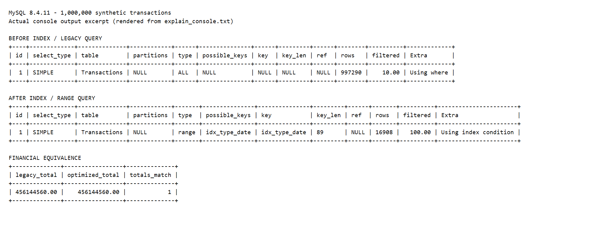

# Bài nộp PayFlow có kết quả thực nghiệm

## 1. payflow_optimized.sql

```sql
-- PayFlow: so sanh EXPLAIN truoc/sau khi them index.
-- CREATE INDEX chi chay mot lan; neu da co idx_type_date, bo qua buoc tao index.
-- Script khong gia lap 5 trieu dong va khong xoa du lieu hien co.
CREATE DATABASE IF NOT EXISTS `payflow_db`;
USE `payflow_db`;

CREATE TABLE IF NOT EXISTS `Transactions` (
    `transaction_id` INT AUTO_INCREMENT PRIMARY KEY,
    `user_id` INT,
    `amount` DECIMAL(15,2),
    `transaction_type` VARCHAR(20),
    `created_at` DATETIME
) ENGINE=InnoDB;

-- 1. Ke hoach legacy TRUOC khi tao index (tren schema legacy trong de).
EXPLAIN
SELECT SUM(`amount`) AS `total_deposit`
FROM `Transactions`
WHERE `transaction_type` = 'DEPOSIT'
  AND YEAR(`created_at`) = 2026
  AND MONTH(`created_at`) = 6;

-- 2. Cot so sanh bang dung truoc, cot so sanh khoang dung sau.
CREATE INDEX `idx_type_date`
ON `Transactions` (`transaction_type`, `created_at`);

ANALYZE TABLE `Transactions`;

-- 3. Ke hoach legacy SAU khi tao index de tach tac dong cua index va refactor.
EXPLAIN
SELECT SUM(`amount`) AS `total_deposit`
FROM `Transactions`
WHERE `transaction_type` = 'DEPOSIT'
  AND YEAR(`created_at`) = 2026
  AND MONTH(`created_at`) = 6;

-- 4. Ke hoach truy van toi uu: khoang nua mo, khong boc ham tren cot ngay.
EXPLAIN
SELECT SUM(`amount`) AS `total_deposit`
FROM `Transactions`
WHERE `transaction_type` = 'DEPOSIT'
  AND `created_at` >= '2026-06-01 00:00:00'
  AND `created_at` <  '2026-07-01 00:00:00';

-- 5. Bao cao thuc te: giu SUM va cach xu ly NULL nhu truy van cu.
SELECT SUM(`amount`) AS `total_deposit`
FROM `Transactions`
WHERE `transaction_type` = 'DEPOSIT'
  AND `created_at` >= '2026-06-01 00:00:00'
  AND `created_at` <  '2026-07-01 00:00:00';

-- 6. Doi chieu ket qua tai chinh tren cung mot snapshot du lieu.
-- NULL-safe equality (<=>) xu ly dung khi ca hai tong deu NULL.
SELECT old_report.`total_deposit` AS `legacy_total`,
       new_report.`total_deposit` AS `optimized_total`,
       old_report.`total_deposit` <=> new_report.`total_deposit` AS `totals_match`
FROM (
    SELECT SUM(`amount`) AS `total_deposit` FROM `Transactions`
    WHERE `transaction_type` = 'DEPOSIT'
      AND YEAR(`created_at`) = 2026 AND MONTH(`created_at`) = 6
) AS old_report
CROSS JOIN (
    SELECT SUM(`amount`) AS `total_deposit` FROM `Transactions`
    WHERE `transaction_type` = 'DEPOSIT'
      AND `created_at` >= '2026-06-01 00:00:00'
      AND `created_at` <  '2026-07-01 00:00:00'
) AS new_report;

-- Tuy chon: EXPLAIN ANALYZE thuc thi truy van, chi dung tren moi truong thu.
-- EXPLAIN ANALYZE
-- SELECT SUM(amount) FROM Transactions
-- WHERE transaction_type = 'DEPOSIT'
--   AND created_at >= '2026-06-01 00:00:00'
--   AND created_at < '2026-07-01 00:00:00';

```

## 2. explain_analysis.md

# Phân tích EXPLAIN trước và sau

| Chỉ số | Legacy trước index | Truy vấn khoảng sau index |
|---|---|---|
| type | ALL | range |
| key | NULL | idx_type_date |
| rows | 997290 | 16908 |

YEAR/MONTH trên created_at không cung cấp khoảng tra cứu trực tiếp cho B-tree thông thường. Index ghép đặt transaction_type trước vì điều kiện bằng, rồi created_at vì điều kiện khoảng. Biên trên loại trừ ngày đầu tháng sau nên giữ đầy đủ tháng 6.

Đã chạy MySQL 8.4.11 trên server thử riêng với 1.000.000 dòng giả lập, không phải 5 triệu giao dịch PayFlow thực tế. Log nguyên bản: explain_console.txt; script tái lập: benchmark_fixture.sql. possible_keys sau tối ưu là idx_type_date; Extra là Using index condition. EXPLAIN ANALYZE đọc thực tế 9120 dòng, tổng hợp khoảng 26,6 ms trong lần chạy này. Chưa đo thời gian truy vấn cũ nên không tính hệ số tăng tốc.

rows là ước lượng. Hai tổng đều 456144560.00, totals_match = 1. Kế hoạch trên dữ liệu sản xuất có thể khác; cần đo lại trước nghiệm thu.

[Tài liệu MySQL: Range Optimization](https://dev.mysql.com/doc/refman/8.4/en/range-optimization.html).


## 3. ai_prompt_log.md

# Nhật ký sử dụng AI

## Yêu cầu thực tế

Người dùng gửi toàn bộ đề PayFlow trong file đính kèm, trong ngữ cảnh nhờ chuẩn bị bài và đẩy GitHub. AI đọc đề, tra tài liệu MySQL chính thức và viết bản nháp. Không có các lượt hỏi đáp kỹ thuật riêng; các prompt mẫu trong đề không được ghi thành lịch sử thực tế.

## Nội dung đã tìm hiểu và áp dụng

- SARGable: điều kiện có thể được dùng để định vị dữ liệu qua index. Khoảng ngày trực tiếp phù hợp hơn YEAR/MONTH trên cột cho index B-tree thông thường.
- Index ghép (transaction_type, created_at) dùng điều kiện bằng ở cột đầu và khoảng ở cột tiếp theo; thứ tự không chỉ được quyết định bằng độ chọn lọc riêng của từng cột.
- ALL: quét bảng; index: quét index; range: đọc khoảng index; ref: tra theo giá trị khóa không duy nhất; const: tối đa một dòng qua khóa duy nhất phù hợp.
- possible_keys là index có thể dùng; key là index được chọn; rows là ước lượng. Không đồng nhất EXPLAIN với phép đo thời gian thực thi.
- Using index condition là lọc điều kiện ở tầng index trước khi đọc dòng; Using index cho biết truy vấn được đáp ứng bằng index. Index hai cột chưa chứa amount nên chưa phải covering index cho SUM(amount).
- Thứ tự logic giản lược: FROM/JOIN → WHERE → GROUP BY → HAVING → SELECT → ORDER BY → LIMIT. Optimizer có thể tổ chức thực thi vật lý khác.
- Quét bảng có thể rẻ hơn tra index khi bảng nhỏ hoặc phải lấy phần lớn dữ liệu. Index bổ sung tăng dung lượng, chi phí ghi và bảo trì.
- SELECT thông thường trên InnoDB không mặc nhiên gây table lock; contention còn phụ thuộc loại giao dịch, isolation, DDL, I/O và tài nguyên. Không kết luận nguyên nhân khóa chỉ từ truy vấn chậm.
- EXPLAIN ANALYZE thực sự chạy truy vấn, nên dùng trên môi trường thử. Không dùng số đo hoặc ảnh giả để chứng minh hiệu năng.

## Tài liệu tham khảo đã tra

- [Range Optimization](https://dev.mysql.com/doc/refman/8.4/en/range-optimization.html)
- [CREATE INDEX](https://dev.mysql.com/doc/refman/8.4/en/create-index.html)
- [Optimization and Indexes](https://dev.mysql.com/doc/refman/8.4/en/optimization-indexes.html)

## Trạng thái kiểm chứng

Đã chạy trên MySQL 8.4.11 với 1.000.000 dòng giả lập trong server riêng. Log thực tế ở explain_console.txt và script ở benchmark_fixture.sql: ALL → range, key = idx_type_date, rows 997290 → 16908. EXPLAIN ANALYZE đọc 9120 dòng. Hai tổng là 456144560.00, totals_match = 1. Không có dữ liệu 5 triệu giao dịch thật hoặc benchmark sản xuất.

## Trao đổi thực tế bổ sung trong phiên này

Prompt của người dùng (trích nguyên văn phản hồi chấm bài):

> Tuy nhiên, điểm yếu lớn nhất là thiếu bằng chứng thực tế về hiệu quả tối ưu hóa (kết quả EXPLAIN từ console) và việc không cung cấp nhật ký các prompt AI đã sử dụng theo yêu cầu của đề bài.

Phản hồi của AI: kiểm tra MySQL cài sẵn, tạo server thử tách biệt, sinh 1.000.000 giao dịch giả lập, chạy EXPLAIN trước/sau và EXPLAIN ANALYZE. Giải thích rằng rows trong EXPLAIN là ước lượng (997290 và 16908), còn 9120 là số dòng thực đọc trong EXPLAIN ANALYZE. So sánh hai tổng trên cùng dữ liệu để kiểm tra không đổi kết quả tài chính.

Đây là prompt thực tế yêu cầu bổ sung qua phản hồi chấm bài, không phải một câu hỏi kỹ thuật độc lập về B-tree do học viên tự đặt. Nhật ký không bổ sung các câu hỏi chưa từng xảy ra để lấy điểm.

## Quy tắc dùng AI của đề

Đề giới hạn AI ở việc giải thích, không viết sẵn lời giải tối ưu cuối cùng. Các file này là bản nháp AI tạo ở phạm vi rộng hơn quy tắc đó. Học viên cần tự thực hành, kiểm tra và trao đổi với giảng viên về mức dùng AI trước khi nộp. Nhật ký không tuyên bố đây là bài tự làm.


## 4. Log console thực tế (dữ liệu giả lập)

```text
--------------
-- Du lieu gia lap de tai lap EXPLAIN, KHONG phai giao dich PayFlow thuc.
--------------

--------------
-- Chay tren server thu rieng. Script tao schema rieng, khong xoa schema san co.
--------------

--------------
CREATE DATABASE `payflow_benchmark`
--------------

--------------
CREATE TABLE Transactions (
    transaction_id INT AUTO_INCREMENT PRIMARY KEY,
    user_id INT,
    amount DECIMAL(15,2),
    transaction_type VARCHAR(20),
    created_at DATETIME
) ENGINE=InnoDB
--------------

--------------
CREATE TABLE digits (n INT PRIMARY KEY)
--------------

--------------
INSERT INTO digits VALUES (0),(1),(2),(3),(4),(5),(6),(7),(8),(9)
--------------

--------------
INSERT INTO Transactions (user_id, amount, transaction_type, created_at)
SELECT MOD(seq.n,10000)+1, CAST(MOD(seq.n,100000)+1 AS DECIMAL(15,2)),
       ELT(MOD(seq.n,3)+1,'DEPOSIT','WITHDRAW','TRANSFER'),
       DATE_ADD('2024-01-01 00:00:00', INTERVAL MOD(seq.n,1096) DAY)
FROM (
    SELECT a.n+10*b.n+100*c.n+1000*d.n+10000*e.n+100000*f.n AS n
    FROM digits a CROSS JOIN digits b CROSS JOIN digits c
    CROSS JOIN digits d CROSS JOIN digits e CROSS JOIN digits f
) seq
--------------

--------------
ANALYZE TABLE Transactions
--------------

+--------------------------------+---------+----------+----------+
| Table                          | Op      | Msg_type | Msg_text |
+--------------------------------+---------+----------+----------+
| payflow_benchmark.transactions | analyze | status   | OK       |
+--------------------------------+---------+----------+----------+
--------------
SELECT VERSION() AS mysql_version, COUNT(*) AS fixture_rows FROM Transactions
--------------

+---------------+--------------+
| mysql_version | fixture_rows |
+---------------+--------------+
| 8.4.11        |      1000000 |
+---------------+--------------+
--------------
SELECT 'BEFORE_INDEX_LEGACY' AS phase
--------------

+---------------------+
| phase               |
+---------------------+
| BEFORE_INDEX_LEGACY |
+---------------------+
--------------
EXPLAIN SELECT SUM(amount) FROM Transactions
WHERE transaction_type='DEPOSIT' AND YEAR(created_at)=2026 AND MONTH(created_at)=6
--------------

+----+-------------+--------------+------------+------+---------------+------+---------+------+--------+----------+-------------+
| id | select_type | table        | partitions | type | possible_keys | key  | key_len | ref  | rows   | filtered | Extra       |
+----+-------------+--------------+------------+------+---------------+------+---------+------+--------+----------+-------------+
|  1 | SIMPLE      | Transactions | NULL       | ALL  | NULL          | NULL | NULL    | NULL | 997290 |    10.00 | Using where |
+----+-------------+--------------+------------+------+---------------+------+---------+------+--------+----------+-------------+
--------------
CREATE INDEX idx_type_date ON Transactions(transaction_type,created_at)
--------------

--------------
ANALYZE TABLE Transactions
--------------

+--------------------------------+---------+----------+----------+
| Table                          | Op      | Msg_type | Msg_text |
+--------------------------------+---------+----------+----------+
| payflow_benchmark.transactions | analyze | status   | OK       |
+--------------------------------+---------+----------+----------+
--------------
SELECT 'AFTER_INDEX_OPTIMIZED' AS phase
--------------

+-----------------------+
| phase                 |
+-----------------------+
| AFTER_INDEX_OPTIMIZED |
+-----------------------+
--------------
EXPLAIN SELECT SUM(amount) FROM Transactions
WHERE transaction_type='DEPOSIT'
AND created_at >= '2026-06-01 00:00:00' AND created_at < '2026-07-01 00:00:00'
--------------

+----+-------------+--------------+------------+-------+---------------+---------------+---------+------+-------+----------+-----------------------+
| id | select_type | table        | partitions | type  | possible_keys | key           | key_len | ref  | rows  | filtered | Extra                 |
+----+-------------+--------------+------------+-------+---------------+---------------+---------+------+-------+----------+-----------------------+
|  1 | SIMPLE      | Transactions | NULL       | range | idx_type_date | idx_type_date | 89      | NULL | 16908 |   100.00 | Using index condition |
+----+-------------+--------------+------------+-------+---------------+---------------+---------+------+-------+----------+-----------------------+
--------------
SELECT 'MEASURED_OPTIMIZED' AS phase
--------------

+--------------------+
| phase              |
+--------------------+
| MEASURED_OPTIMIZED |
+--------------------+
--------------
EXPLAIN ANALYZE SELECT SUM(amount) FROM Transactions
WHERE transaction_type='DEPOSIT'
AND created_at >= '2026-06-01 00:00:00' AND created_at < '2026-07-01 00:00:00'
--------------

+--------------------------------------------------------------------------------------------------------------------------------------------------------------------------------------------------------------------------------------------------------------------------------------------------------------------------------------------------------------------------------------------------------------------------------------------------------------------------------------------------------------------------------------------+
| EXPLAIN                                                                                                                                                                                                                                                                                                                                                                                                                                                                                                                                    |
+--------------------------------------------------------------------------------------------------------------------------------------------------------------------------------------------------------------------------------------------------------------------------------------------------------------------------------------------------------------------------------------------------------------------------------------------------------------------------------------------------------------------------------------------+
| -> Aggregate: sum(transactions.amount)  (cost=9300 rows=1) (actual time=26.6..26.6 rows=1 loops=1)
    -> Index range scan on Transactions using idx_type_date over (transaction_type = 'DEPOSIT' AND '2026-06-01 00:00:00' <= created_at < '2026-07-01 00:00:00'), with index condition: ((transactions.transaction_type = 'DEPOSIT') and (transactions.created_at >= TIMESTAMP'2026-06-01 00:00:00') and (transactions.created_at < TIMESTAMP'2026-07-01 00:00:00'))  (cost=7609 rows=16908) (actual time=3.96..25.8 rows=9120 loops=1)
 |
+--------------------------------------------------------------------------------------------------------------------------------------------------------------------------------------------------------------------------------------------------------------------------------------------------------------------------------------------------------------------------------------------------------------------------------------------------------------------------------------------------------------------------------------------+
--------------
SELECT old_report.total AS legacy_total, new_report.total AS optimized_total,
       old_report.total <=> new_report.total AS totals_match
FROM (SELECT SUM(amount) AS total FROM Transactions
WHERE transaction_type='DEPOSIT' AND YEAR(created_at)=2026 AND MONTH(created_at)=6) old_report
CROSS JOIN (SELECT SUM(amount) AS total FROM Transactions
WHERE transaction_type='DEPOSIT'
AND created_at >= '2026-06-01 00:00:00' AND created_at < '2026-07-01 00:00:00') new_report
--------------

+--------------+-----------------+--------------+
| legacy_total | optimized_total | totals_match |
+--------------+-----------------+--------------+
| 456144560.00 |    456144560.00 |            1 |
+--------------+-----------------+--------------+

```

Ảnh dưới đây là bản render từ log console thật, không phải ảnh chụp MySQL Workbench.

